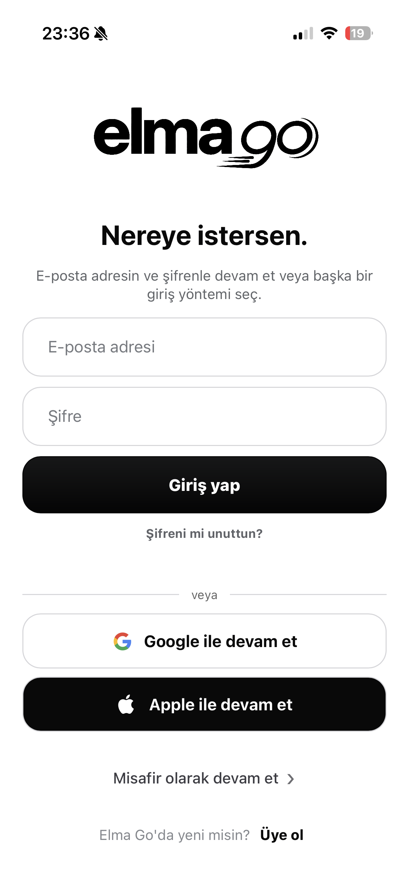
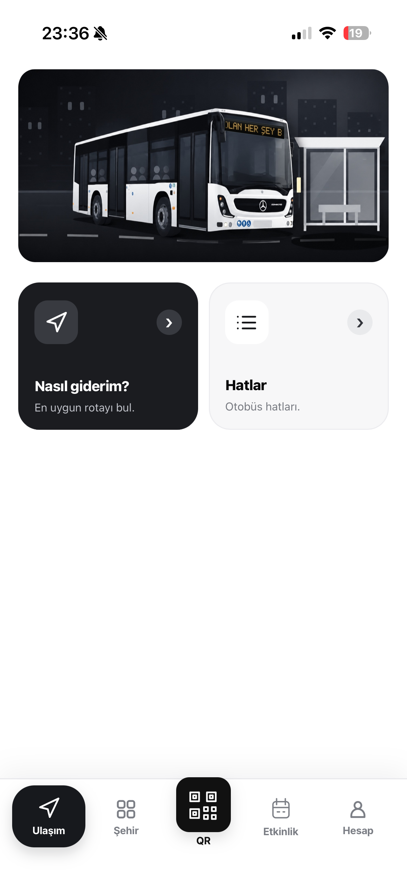
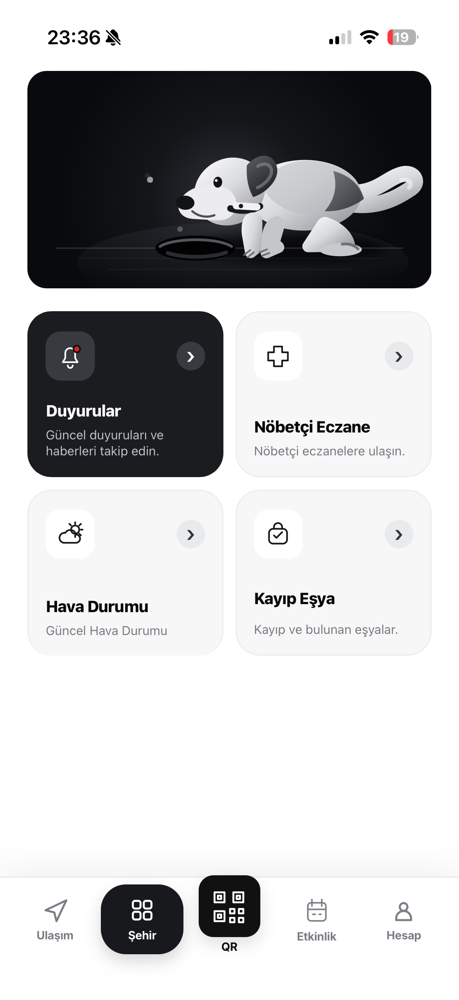
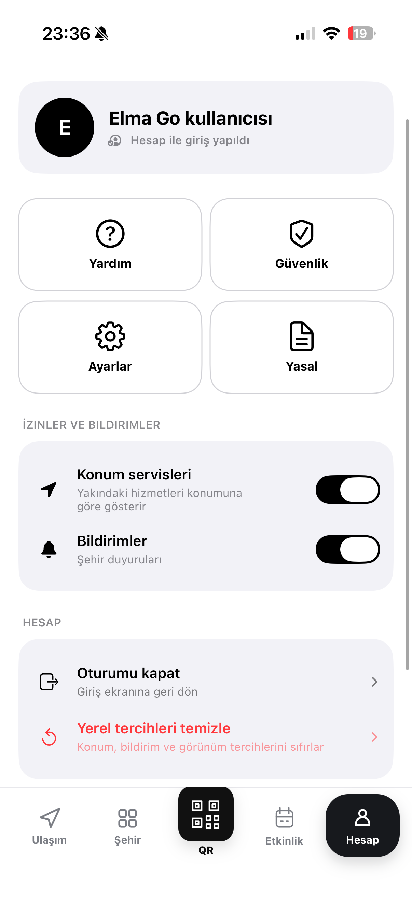
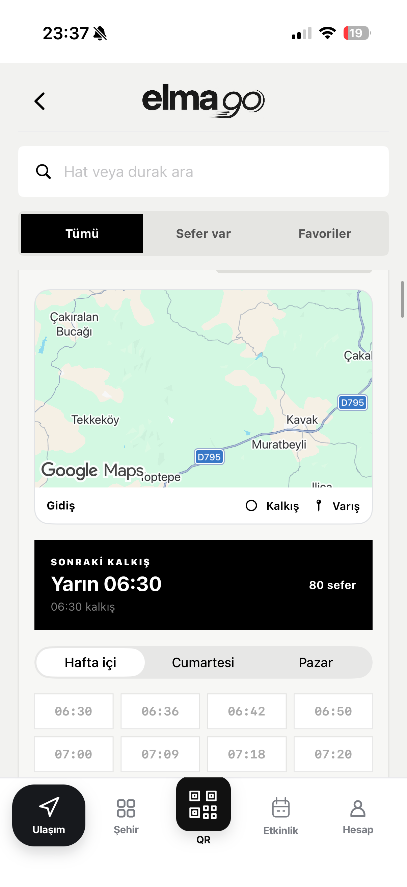
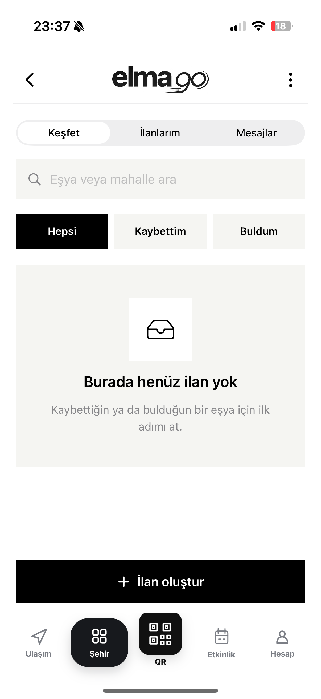

# ELMA Go — iOS City & Transportation App

**A working iPhone app prototype for local transportation and city services in Amasya, Türkiye.**

Independently created using AI-assisted development tools, ELMA Go explores how transportation, practical city information and community services can come together in a single mobile experience.

## App screenshots

Real screenshots from the running iOS prototype:

## What ELMA Go demonstrates

| Area | Screens and capabilities |
| --- | --- |
| Welcome and sign-in | Email/password entry, Google and Apple sign-in options, and guest entry UI |
| Transportation | Route search, origin/destination selection, Google Maps display, bus line discovery |
| Bus schedules | Route information, departure timetable UI and filters |
| City services | Announcements, on-duty pharmacy, weather and lost-and-found entry points |
| Lost and found | Listing discovery, lost/found categories, search and create-listing UI |
| Account | Profile, settings, help, security and preference controls |

*Screenshots demonstrate the app's interface. They do not by themselves verify that every external service or backend workflow is production-ready.*

## Project details

- **Platform:** iOS / iPhone
- **Technologies:** Swift, SwiftUI, Google Maps
- **Development:** Independently built with AI-assisted coding tools
- **Status:** Working prototype; **not yet published on the App Store**
- **Data note:** Transit schedules and arrivals use prototype data; real-time feeds are not integrated.

## Freelance projects

I build early-stage mobile app concepts, functional prototypes and MVPs with AI-assisted workflows. My focus is turning an idea into a usable interface and a testable app. ELMA Go is a practical example of this work.

For a project inquiry or a walkthrough, please contact me through my [GitHub profile](https://github.com/Nyks050).

## Source code

The complete iOS application source is in a **private repository**. This public repository is a portfolio showcase.
